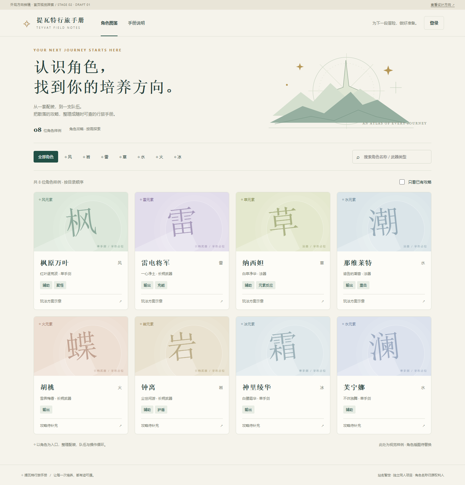
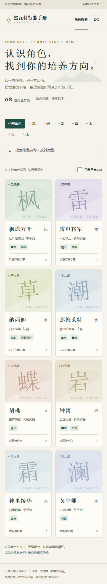

# 初步外观方向

日期：2026-10-11。依据：[需求与验收标准 PRD.md](PRD.md) V2.0。

当前只确定外观方向，交付一张可在浏览器打开的首页样稿。暂不展开角色详情、后台、完整操作流程或业务开发。原需求文档保持不变。

## 已选择的风格

**浅色冒险手册**：米白纸页、深青导航与文字、少量金色点缀，角色卡片以低饱和元素色区分。整体接近一本清晰、安静的攻略图鉴。

| 视觉项 | 初步方向 |
| --- | --- |
| 页面背景 | 米白 `#F5F3EB` |
| 卡片背景 | 暖白 `#FDFCF7`，细边框、轻阴影、小圆角 |
| 主文字 | 深青 `#233C38` |
| 主按钮 / 选中态 | 深绿 `#214F45` |
| 点缀色 | 古金 `#AB843E`，用于小标题、星形与细节 |
| 字体 | 标题采用宋体风格，正文采用系统无衬线字体 |
| 装饰 | 简洁山形、罗盘与星形线条，不遮挡攻略信息 |
| 角色图片 | 目前用字形占位；正式角色图的素材来源与裁切方案后续确定 |
| 布局 | 桌面四列角色卡，平板三列，窄屏两列 |

## 首页样稿表达的内容

顶部品牌与导航 → 简短主题介绍 → 元素筛选与搜索 → 角色目录卡片。通过卡片区分“已有攻略”与“攻略待补充”，保留需求中以角色为入口的组织方式。

暂定站名为“提瓦特行旅手册”，不是已确定的正式名称。角色、标签和攻略状态为布局样例。搜索与筛选仅帮助查看样式，登录与角色卡不会进入真实业务页面。

## 本轮看什么

先确认整体是否足够清爽、是否有冒险手册的气氛，以及角色卡的大小、留白和文字层级是否合适。方向确定后，再细化角色攻略页和后台页面。

打开方式：双击 `样稿/原型/index.html`，无需安装依赖，不依赖外部图片或字体。

## 附：外观样稿

- [首页 HTML 样稿](样稿/原型/index.html)
- [桌面效果图](样稿/首页外观-桌面.png)
- [手机效果图](样稿/首页外观-手机.png)

### 桌面预览

### 手机预览

